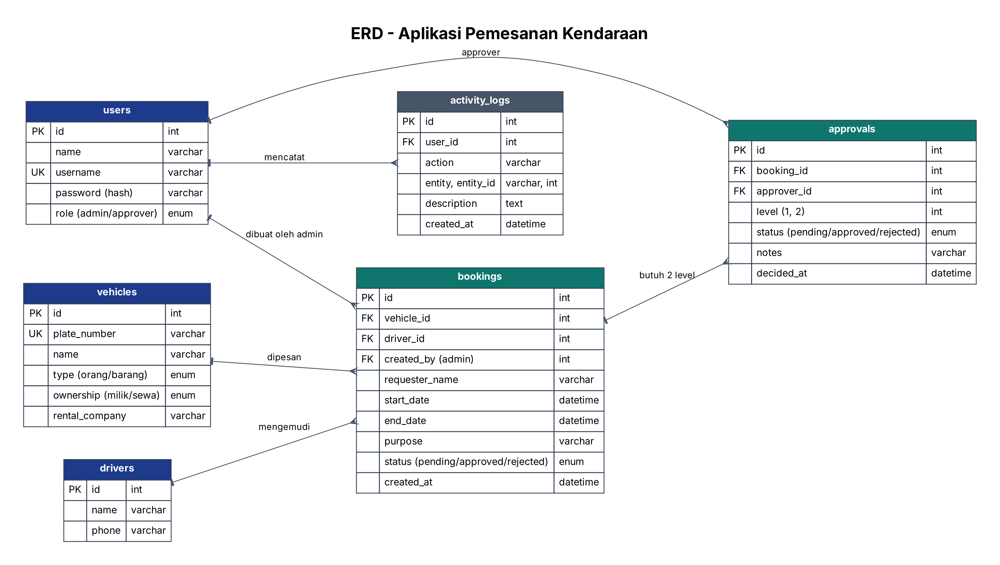
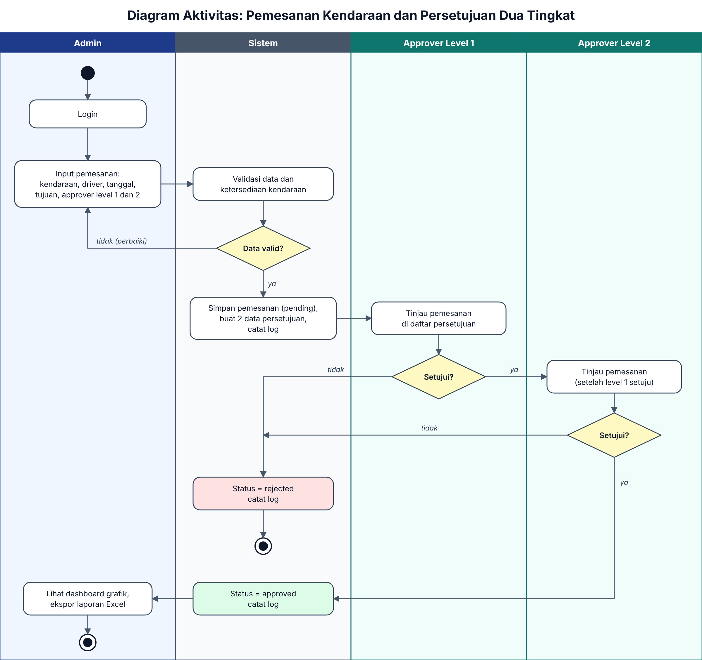
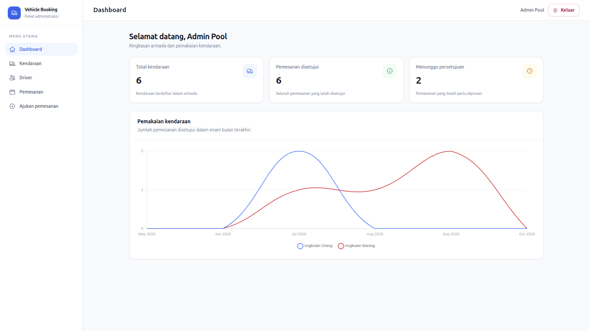
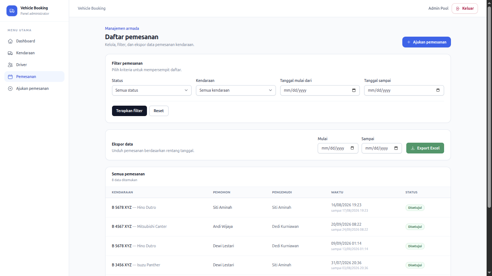
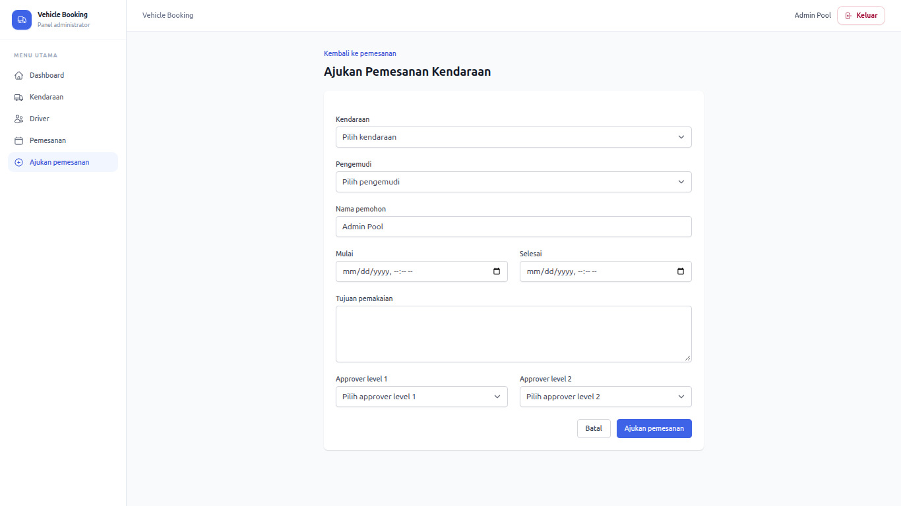
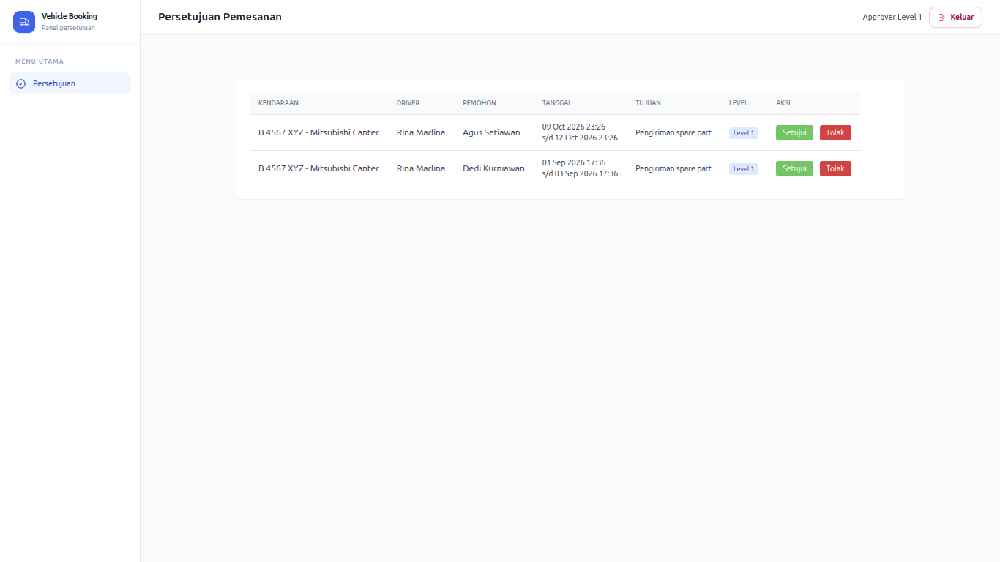
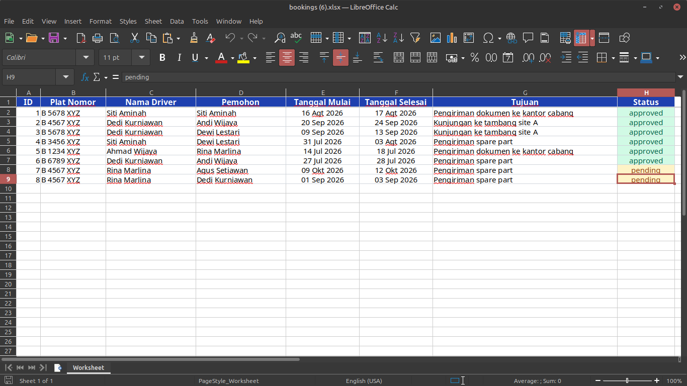

# Vehicle Booking

Aplikasi pemesanan kendaraan untuk perusahaan tambang nikel. Setiap pemesanan memerlukan persetujuan dua tingkat sebelum kendaraan digunakan.

## Teknologi

Versi di bawah diambil dari lingkungan proyek dan berkas dependensinya.

- PHP 8.3.6 (CLI); `composer.json` mensyaratkan PHP `^8.3`.
- Laravel 13.36.0 (`composer.lock`).
- PostgreSQL 14+.
- Tailwind CSS 3.4.19 (`package-lock.json`).
- Chart.js 4.4.0 melalui CDN.
- Maatwebsite Excel 4.0.4.

## Instalasi

Pastikan PHP, Composer, Node.js, npm, dan PostgreSQL 14+ sudah tersedia. Buat database `vehicle_booking` sebelum menjalankan migrasi.

```bash
composer install
cp .env.example .env
php artisan key:generate
createdb -U postgres vehicle_booking
php artisan migrate --seed
npm install
npm run build
php artisan serve
```

> Buka alamat yang ditampilkan oleh `php artisan serve`.

## Akun demo

Seeder membuat akun berikut dengan kata sandi `password`. Login menggunakan **email**, bukan username.

| Peran            | Username    | Email untuk login       | Kata sandi |
| ---------------- | ----------- | ----------------------- | ---------- |
| Admin            | `admin`     | `admin@company.com`     | `password` |
| Approver level 1 | `approver1` | `approver1@company.com` | `password` |
| Approver level 2 | `approver2` | `approver2@company.com` | `password` |

> Akun dan kata sandi tersebut hanya untuk data demo hasil seeder.

## Panduan pengguna

1. **Admin** masuk, mengelola kendaraan dan driver, lalu membuat pemesanan dengan memilih approver level 1 dan level 2.
2. **Approver level 1** meninjau pemesanan dan menyetujui atau menolaknya.
3. **Approver level 2** dapat memproses pemesanan setelah approver level 1 menyetujuinya.
4. Penolakan di salah satu tingkat mengubah status pemesanan menjadi `rejected`.
5. Admin melihat ringkasan dan grafik pada dashboard serta mengekspor laporan Excel berdasarkan rentang tanggal.

## Aturan bisnis

- Jadwal kendaraan yang bertabrakan dengan pemesanan berstatus `pending` atau `approved` ditolak.
- Approver level 2 tidak dapat memproses pemesanan sebelum persetujuan level 1 diberikan.
- Aktivitas login, logout, pemesanan, persetujuan, penolakan, perubahan kendaraan/driver, dan ekspor dicatat di tabel `activity_logs`.

## Diagram





## Screenshot











## Menjalankan tes

```bash
php artisan test
```
